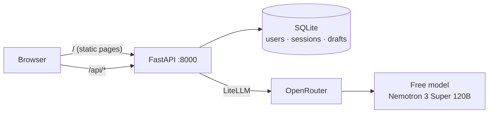

<div align="center">

# PreLegal

**Draft legal agreements by chatting with an AI.**

Describe the deal in plain English. PreLegal asks the right questions and fills in a complete agreement beside the chat, using [Common Paper](https://commonpaper.com/standards/) standard templates.


[Features](#features) · [Quick start](#quick-start) · [Using PreLegal](#using-prelegal) · [How it works](#how-it-works) · [Development](#development) · [Configuration](#configuration)

</div>

> **Draft only.** Documents generated by PreLegal are drafts and are subject to legal review. They are not legal advice. Have a qualified lawyer review any agreement before signing it.

---

## Features

| | |
| --- | --- |
| 💬 **Conversational drafting** | Skip the forms. The AI works out which agreement you need and fills in each field from your answers. |
| 📄 **Live preview** | The full agreement, with a cover page and signature block, updates as you chat. |
| 🔀 **Switch mid-chat** | Change your mind and move to a different agreement. Answers the two documents share are kept. |
| 💾 **Saved automatically** | Every draft is stored under **My documents**. Reopen one and carry on where you left off. |
| 🔐 **Your own account** | Sign up and sign in. Each user only ever sees their own drafts. |
| 🖨️ **PDF download** | Save the finished agreement as a PDF. |
| 💸 **Zero AI cost** | Runs on a free OpenRouter model. Paid models are refused outright. |

### Agreements available

| Agreement | Use it for |
| --- | --- |
| Mutual Non-Disclosure Agreement | Two parties sharing confidential information |
| Cloud Service Agreement | Providing a SaaS or cloud product to a customer |
| Software License Agreement | Licensing software to a customer |
| Professional Services Agreement | Services delivered under statements of work |
| Pilot Agreement | A short-term trial before a full commercial deal |
| Design Partner Agreement | Early access in exchange for product feedback |
| Partnership Agreement | Referral, reseller or co-marketing arrangements |
| Service Level Agreement | Uptime targets, support response times, service credits |
| Data Processing Agreement | Handling personal data between a provider and a customer |
| Business Associate Agreement | Handling protected health information under HIPAA |
| AI Addendum | Supplemental terms for a provider's AI services |

---

## Quick start

You need [Docker](https://docs.docker.com/get-docker/) (running) and a free [OpenRouter API key](https://openrouter.ai/keys).

**1. Get the code**

```bash
git clone https://github.com/codebybishwa/prelegal.git
cd prelegal
```

**2. Add your API key.** Create a file named `.env` in the `prelegal` folder:

```text
OPEN_ROUTER_API_KEY=your-key-here
```

**3. Start the app**

| OS      | Start                       | Stop                       |
| ------- | --------------------------- | -------------------------- |
| Mac     | `scripts/start-mac.sh`      | `scripts/stop-mac.sh`      |
| Linux   | `scripts/start-linux.sh`    | `scripts/stop-linux.sh`    |
| Windows | `scripts/start-windows.ps1` | `scripts/stop-windows.ps1` |

The first start builds the image and takes a few minutes.

**4. Open <http://localhost:8000>**

> The database is temporary and is reset every time the app starts, so accounts and saved drafts last only until the next restart.

---

## Using PreLegal

1. **Create an account.** On the sign-in page choose **Create an account** and use an email and a password of at least 8 characters.
2. **Say what you need.** For example: *"An NDA between Acme Inc and Globex, under Delaware law."*
3. **Answer the questions.** The assistant asks about the parties and terms a couple at a time. The agreement on the right fills in as you go.
4. **Review and download.** Read the preview, then click **Download PDF** and choose *Save as PDF* in the print dialog.
5. **Come back later.** Open **My documents** to see every draft, newest first. Click **Continue** to resume the conversation and edit the document.

Click **New document** at any time to start a fresh one.

### Troubleshooting

| Problem | Fix |
| --- | --- |
| The chat says the AI is not configured | Check that `.env` is in the project root and has `OPEN_ROUTER_API_KEY`. Then restart the app. |
| The chat says the free AI model is busy | Free models are rate-limited. Wait a moment and click **Retry**. |
| Can't sign in after restarting | Accounts are wiped on every restart. Create a new one. |
| Port 8000 is already in use | Stop the other program, or change the port mapping in `docker-compose.yml`. |

---

## How it works



Each chat turn goes like this:

1. The browser sends the conversation, the selected document and its current values to `POST /api/chat`.
2. The backend asks the model for a **structured JSON** reply: what to say, which document to select, and which fields to update. Field names are restricted to the ones in the chosen document.
3. The backend validates every value (dates, terms, unknown fields) and drops anything invalid, then saves the turn to the user's draft.
4. The frontend re-renders the agreement from the returned values.

The model never writes legal text. It only fills in fields of Common Paper's templates, so the wording of each agreement stays exactly as published.

### Built with

| Layer | Technology |
| --- | --- |
| Frontend | Next.js 16 (static export), React 19, Tailwind CSS 4 |
| Backend | Python 3.12, FastAPI, managed with [`uv`](https://docs.astral.sh/uv/) |
| Database | SQLite, recreated on every start |
| AI | LiteLLM → OpenRouter → a free model, with strict JSON Schema outputs |
| Packaging | One Docker container |

### Project layout

```text
prelegal/
├── backend/          FastAPI app (auth, drafts, AI chat) and its tests
├── frontend/         Next.js app and its tests
├── templates/        Common Paper agreement templates (Markdown)
├── catalog.json      Index of the templates
├── documents.json    Every agreement's fields and parties (used by backend and frontend)
├── scripts/          Start and stop scripts for Mac, Linux and Windows
├── Dockerfile        Builds the frontend, then the runtime image
└── docker-compose.yml
```

To support a new agreement, add its template to `templates/` and describe it in `documents.json`.

### Security and cost safeguards

- Passwords are hashed with scrypt. Sessions use an `HttpOnly`, `SameSite=Lax` cookie, and only a hash of the session token is stored.
- All chat and draft endpoints require a signed-in user. One user can never read or change another's drafts.
- The backend **refuses any model that isn't a free OpenRouter model** and never falls back to a paid one. If the free model is down, you get a clear error instead of a bill.
- The API key lives in `.env`, which is git-ignored.

---

## Development

You don't need Docker to develop. Run the backend against a fresh frontend build:

```bash
cd frontend && npm install && npm run build
cd ../backend && uv run uvicorn app.main:app --port 8000
```

Open <http://localhost:8000>. For hot reloading of the frontend, run `npm run dev` in `frontend/` and open <http://localhost:3000>; it proxies `/api` to the backend on port 8000.

| Task | Command |
| --- | --- |
| Backend tests | `cd backend && uv run pytest` |
| Frontend tests | `cd frontend && npm test` |
| Frontend lint and types | `cd frontend && npm run lint && npx tsc --noEmit` |
| Tests against the real free model | `cd backend && PRELEGAL_LIVE_LLM_TESTS=1 uv run pytest -k live` |

The regular tests mock the AI, so they run offline and cost nothing. Backend API details are in [`backend/README.md`](backend/README.md).

## Configuration

Set these as environment variables, or in `.env` when using Docker.

| Variable | Default | Purpose |
| --- | --- | --- |
| `OPEN_ROUTER_API_KEY` | _(required)_ | Your OpenRouter key |
| `PRELEGAL_LLM_MODEL` | `openrouter/nvidia/nemotron-3-super-120b-a12b:free` | The model to use. Must end in `:free`. |
| `PRELEGAL_COOKIE_SECURE` | off | Set to `1` when serving over HTTPS so the session cookie is only sent securely |
| `PRELEGAL_DB_PATH` | `backend/data/prelegal.db` | Where the SQLite file is created |
| `PRELEGAL_STATIC_DIR` | `frontend/out` | The built frontend to serve |

## Roadmap

- [x] Chat-driven drafting of 11 agreement types
- [x] Accounts, saved drafts and **My documents**
- [ ] Server-side PDF export (today it uses the browser's print dialog)
- [ ] Sign-in rate limiting

## License

[MIT](LICENSE) © 2026 Bishwamohan Jena. The agreement templates in `templates/` are from [Common Paper](https://commonpaper.com/standards/) and are licensed under [CC BY 4.0](templates/LICENSE.txt).
